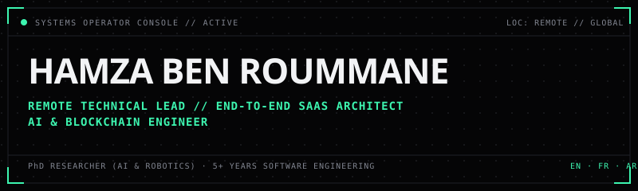
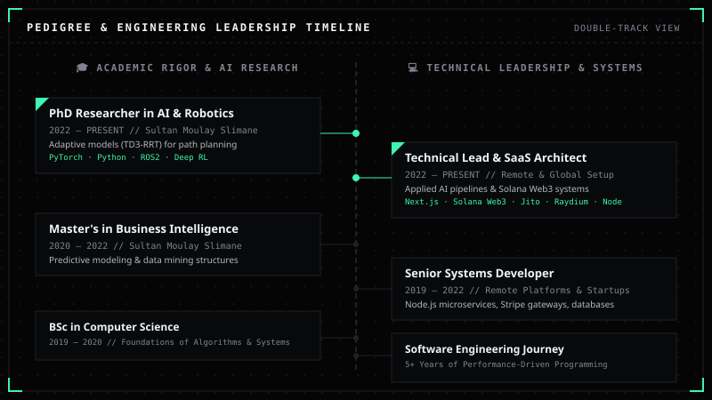

  

> [!IMPORTANT]
> **Tech Entrepreneur | Bootstrapped SaaS Founder & Architect | AI, Growth & Full-Stack Engineering • PhD Researcher in Deep RL • 5+ Years Shipping & Scaling Products**
> Operating at the intersection of PhD-level Artificial Intelligence research, end-to-end SaaS engineering, and data-driven growth marketing. Building, shipping, and scaling profitable software ventures from zero to production.

---

### 🎓 Pedigree, Entrepreneurship & Engineering Leadership

  

  
<b>🔍 SYSTEM INDEX: CLICK TO EXPAND TEXT-BASED TIMELINE & ACADEMICS (SEO ARCHIVE)</b>

   

| 🎓 Academic Rigor & AI Research | 🚀 Tech Entrepreneurship, SaaS & Growth |
| :--- | :--- |
| **PhD Candidate in AI & Robotics** (2022 — Present) *Sultan Moulay Slimane University* • Researching Deep Reinforcement Learning (DRL) algorithms for autonomous navigation (TD3, Soft Actor-Critic). • Developing hybrid path planning and safety-critical control models. • *Tech: Python, PyTorch, ROS2, Gazebo, Deep RL* | **Tech Entrepreneur & Bootstrapped SaaS Architect** (2022 — Present) *Independent Venture Studio (Remote)* • Building and scaling a portfolio of bootstrapped AI and SaaS products from concept to profitability. • Driving end-to-end product architecture, LLM workflows, Paid Ads acquisition, SEO, and conversion funnels. • *Stack: Next.js, TypeScript, Node.js, Python, PostgreSQL, Stripe, Analytics* |
| **Master's in Business Intelligence** (2020 — 2022) *Sultan Moulay Slimane University* • Designed predictive models, high-performance data pipelines, analytics dashboards, and decision support architectures. | **Senior Full-Stack & Systems Engineer** (2019 — 2022) *Remote Startups & FinTech Platforms* • Designed scalable database schemas, high-concurrency Node.js microservices, and real-time Web3/FinTech data pipelines. |
| **Bachelor's in Computer Science** (2019 — 2020) *Sultan Moulay Slimane University* • Core software engineering foundations, distributed systems, data structures, and algorithms. | **Software Engineering & Product Journey** (5+ Years) *SaaS, AI & Automation Systems* • Shipping secure, modular web applications, automated data engines, and scalable cloud architectures. |

---

### ⚡ Core Subsystems (Capabilities)

> [!TIP]
> **APPLIED AI & PRODUCTION LLM SYSTEMS**
> * Custom model training and LLM fine-tuning, RAG (Retrieval-Augmented Generation) architectures, multi-language NLP pipelines, deep reinforcement learning (DRL), and cost-aware inference infrastructure.
> * *Tech Stack: PyTorch, Python, Hugging Face, Custom LLM Routing, Vector DBs, ROS2, Gazebo.*

> [!TIP]
> **END-TO-END BOOTSTRAPPED SAAS ENGINEERING**
> * Complete product lifecycle delivery: rapid MVP validation, multi-tenant database architectures, concurrent Node.js/Python backends, Next.js interfaces, international subscription billing, and cloud deployment.
> * *Tech Stack: Next.js, TypeScript, React, Node.js, PostgreSQL, Supabase, MongoDB, Docker, Stripe.*

> [!TIP]
> **GROWTH MARKETING, PAID ADS & MONETIZATION ENGINE**
> * Full-funnel user acquisition and revenue scaling: Paid Advertising (Google Ads, Meta Ads, PPC), technical & programmatic SEO, Conversion Rate Optimization (CRO), A/B testing, onboarding paywalls, and product analytics.
> * *Growth Stack: Paid Acquisition, Technical SEO, PostHog / Product Analytics, Funnel Optimization, CAC/LTV Modeling.*

---

### 🚀 Venture Studio & Shipping Scale (6+ Bootstrapped Products)

<table>
  <tr>
    <td width="50%" valign="top">
      <h3>🧠 AI & NLP SaaS Portfolio</h3>
      
<b>Bootstrapped B2C & B2B SaaS Products (Stealth)</b>

      
Architected, launched, and scaled multiple self-funded AI software platforms powered by custom fine-tuned LLMs. Engineered entirely end-to-end—from multi-language inference pipelines and subscription billing to paid ad campaigns (PPC/Social Ads), SEO, and automated conversion funnels.

      
<b>Focus:</b> <i>LLM Infrastructure • Subscription SaaS • Paid Acquisition & CRO</i>

    </td>
    <td width="50%" valign="top">
      <h3>⚡ FinTech, Web3 & Automation Engines</h3>
      
<b>High-Throughput Transaction & Data Platforms (Stealth)</b>

      
Engineered real-time distributed applications, automated workflow engines, and non-custodial Web3 integrations. Built with TypeScript, Node.js, and Web3.js to process live on-chain data streams, wallet authentication flows, and sub-second automated transactions at scale.

      
<b>Focus:</b> <i>Real-Time Data Pipelines • Web3.js • High-Concurrency Backend</i>

    </td>
  </tr>
  <tr>
    <td colspan="2" align="center">
      <b>📈 6+ live bootstrapped products shipped to production — combining deep technical architecture with profitable user acquisition.</b>
    </td>
  </tr>
</table>

---

### 📊 System Diagnostics & Metrics

  
<b>SYSTEM STATS & LANGUAGE DISTRIBUTION</b>

   
  

    
    &nbsp;&nbsp;&nbsp;&nbsp;
    
  

  
<b>COMMIT STREAK DIAGNOSTIC</b>

   
  

    
  

  
<b>SYSTEM ACTIVITY GRAPH</b>

   
  

    
  

---

### 🐍 Contribution Activity

  <picture>
    <source
      media="(prefers-color-scheme: dark)"
      srcset="https://raw.githubusercontent.com/hamza97benroummane/hamza97benroummane/output/github-contribution-grid-snake-dark.svg"
    />
    <source
      media="(prefers-color-scheme: light)"
      srcset="https://raw.githubusercontent.com/hamza97benroummane/hamza97benroummane/output/github-contribution-grid-snake.svg"
    />
    
  </picture>

---

  

    <b>DIRECT COMMUNICATIONS:</b> 
    <a href="mailto:hamza@hamzabnr.com">hamza@hamzabnr.com</a> • 
    <a href="https://www.linkedin.com/in/hamza-benroummane/">LinkedIn</a> • 
    <a href="https://hamzabnr.com">Portfolio Website</a>
  

